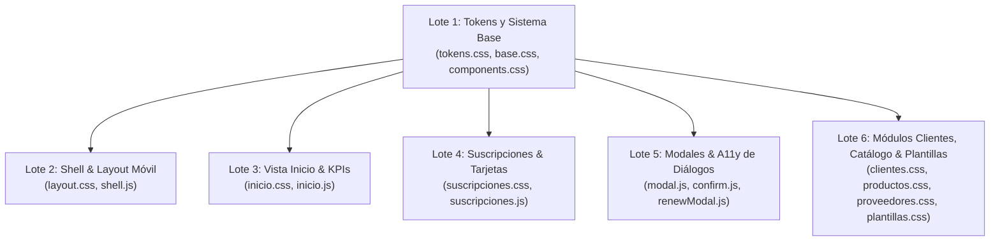

# Auditoría de Diseño UI/UX: PRO VENTAS GC
> Diagnóstico de interfaz, accesibilidad WCAG AA y consistencia visual bajo la metodología **Impeccable**.

**Fecha:** 3 de noviembre de 2026  
**Rama:** `refactor/ux-limpieza` (commits base `2f0f282` y `52d757f`)  
**Entorno de evaluación:** Viewport Móvil (360px × 780px) y Viewport Escritorio (1280px × 800px)  
**Rol del producto:** Herramienta interna operativa de alta densidad para Alex y Liz (reemplazo de Excel, gestión de suscripciones digitales, cobranza y entrega rápida de credenciales por WhatsApp).

---

## 1. Resumen Ejecutivo

### Puntuación de Calidad por Pantalla y Módulo
*Escala técnica Impeccable (0 a 4): 0 = Inaccesible/Roto, 1 = Problemas mayores, 2 = Parcial/Fricción perceptible, 3 = Bueno/Estable (WCAG AA), 4 = Excelente/Artesanal.*

| Módulo / Pantalla | UX & Carga Cognitiva | A11y & Ergonomía Móvil | Theming & Tokens | Puntaje General | Estado |
| :--- | :---: | :---: | :---: | :---: | :--- |
| **A: Login y Recuperación** | 3.0 | 2.5 | 2.8 | **2.8 / 4.0** | Aceptable |
| **B: Inicio (KPIs, Atención, Finanzas)** | 2.8 | 2.2 | 2.4 | **2.5 / 4.0** | Fricción móvil |
| **C: Suscripciones (Cards, Filtros, Resumen)**| 3.1 | 2.4 | 2.4 | **2.6 / 4.0** | Fricción móvil |
| **D: Modales (Nueva Sub, Renovación, Creds)** | 3.0 | 2.6 | 2.6 | **2.7 / 4.0** | A11y & Scroll |
| **E: Clientes, Catálogo, Proveedores, Plantillas** | 2.2 | 2.0 | 2.1 | **2.1 / 4.0** | Ruptura CSS |
| **F: Shell (Sidebar, Drawer, Bottom Nav)** | 3.2 | 2.8 | 2.7 | **2.9 / 4.0** | Estable |
| **Consistencia del Sistema de Diseño** | 2.4 | 2.2 | 2.0 | **2.2 / 4.0** | Deriva de tokens |
| **PROMEDIO GLOBAL PONDERADO** | — | — | — | **2.5 / 4.0** | **Requiere pulido** |

---

### Los 5 Problemas que Más Afectan el Uso Diario (Alex y Liz)

1. **Ruptura de estilo del buscador en Clientes, Catálogo y Proveedores (Crítico):**  
   El buscador en estas tres vistas (`src/views/clientes.js`, `productos.js`, `proveedores.js`) utiliza la clase `.search-box`, pero sus estilos quedaron exclusivamente encapsulados bajo el selector específico `.subs-search-box` en `suscripciones.css`. Como resultado, en 3 de los 4 módulos el buscador se renderiza desalineado, sin icono posicionado ni botón de limpiar, impactando directamente la tarea #1 de Alex/Liz: *encontrar un cliente o servicio rápido*.
2. **Acciones primarias de tarjeta comprimidas y con área táctil insuficiente en móvil (Crítico):**  
   En 360px, los tres botones principales de la tarjeta de suscripción (*Renovar*, *Cobrar*, *Copiar todo*) se fuerzan en una grilla de 3 columnas de apenas ~94px de ancho con `min-height: 40px` y fuentes de 12px. En la vista *Inicio*, los botones usan `.btn-small` con altura efectiva de ~26px. Al operar el teléfono con una sola mano mientras chatean por WhatsApp, Alex o Liz sufren toques accidentales entre "Cobrar" y "Renovar", o toques fallidos.
3. **Ausencia del botón "Copiar accesos" en la sección de atención urgente de Inicio (Alto):**  
   La segunda tarea más frecuente es copiar credenciales para enviarlas al cliente. En *Inicio* ("Requieren atención"), las filas solo presentan botones para "Cobrar", "Renovar" y "Ver". Para copiar las credenciales de un cliente que vence hoy, el operador está obligado a pulsar "Ver", esperar la navegación a *Suscripciones*, localizar la tarjeta y luego copiar todo (3 toques y ~5 segundos adicionales por cliente).
4. **Colisión de Toasts con la Barra de Navegación Inferior Móvil (Alto):**  
   El contenedor de notificaciones flotantes `.toast-area` tiene fijada la posición `bottom: 20px; z-index: 99999;`. En celulares (≤ 640px), la barra de navegación `.mobile-bottom-nav` tiene una altura de `56px + env(safe-area-inset-bottom)`. Toda notificación de confirmación (*"Copiado"*, *"Suscripción renovada"*, etc.) tapa los accesos inferiores a "Suscrip." y "Clientes", bloqueando la navegación táctil.
5. **Deriva de tokens: 5 variables inexistentes, 88 colores hex y 311 espaciados hardcodeados (Alto):**  
   Se detectó el uso de variables inexistentes en `tokens.css`: `--status-info-bg`, `--status-info-border`, `--status-info-text` en alertas de autenticación (`layout.css:415`), y `--bg-surface` en clientes (`clientes.css:53, 173`) y plantillas (`plantillas.css:99`). Al no tener fallback, se renderizan transparentes o negros. Además, el detector Impeccable arrojó el antipatrón de IA `side-tab` (`border-left: 3px solid ...` en `inicio.css:57`) y decenas de valores fuera de la escala de 4px (`5px`, `7px`, `9px`, `14px`, `18px`, `22px`, `28px`).

---

## 2. Hallazgos Agrupados por Severidad

### Severidad: CRÍTICO (Bloqueo o degradación severa de tareas clave)

#### [H-01] Buscador desalineado e inoperante visualmente en Clientes, Productos y Proveedores
- **Pantalla:** E (Clientes, Catálogo de Productos, Proveedores)
- **Ancho:** 360px y 1280px
- **Qué pasa:** El contenedor del buscador en `clientes.js`, `productos.js` y `proveedores.js` utiliza las clases HTML `.search-box`, `.search-icon` y `.search-clear`. Sin embargo, las reglas CSS solo existen para `.subs-search-box`, `.subs-search-icon` y `.subs-search-clear` dentro de `src/styles/views/suscripciones.css`. El buscador carece de posición relativa, el icono SVG queda montado arbitrariamente fuera de lugar y el botón de limpiar carece de estilos.
- **Por qué importa para Alex/Liz:** La tarea diaria #1 es encontrar un cliente o producto en 2 segundos mientras se responde un WhatsApp. En 3 vistas clave la barra de búsqueda se ve deformada e inestable.
- **Archivo y selector:**
  - HTML: `src/views/clientes.js:32`, `src/views/productos.js:32`, `src/views/proveedores.js:32`
  - CSS: `src/styles/views/suscripciones.css:29-73` (no exportado a `components.css`)
- **Corrección concreta recomendada:** Extraer el componente a `src/styles/components.css` bajo la clase genérica `.search-box`, `.search-icon`, `.search-clear` (o `.app-search-box`) con altura normalizada de 44px en móvil y 40px en escritorio, y reutilizarlo en las 4 vistas.
- **Comando Impeccable:** `/impeccable extract components/search` o `/impeccable normalize`

---

#### [H-02] Botones de acción en tarjetas de suscripción violan área táctil mínima (≤ 40px y 26px) y saturan fila en 360px
- **Pantalla:** B (Inicio) y C (Suscripciones)
- **Ancho:** 360px (Móvil)
- **Qué pasa:**  
  1. En `src/views/inicio.js` (fila de atención), los botones "Cobrar", "Renovar" y "Ver" utilizan `.btn-small`, cuya altura calculada es de apenas ~26px (`padding: 5px 9px; font-size: 12px;` en `base.css:84`), incumpliendo ampliamente la pauta WCAG AA (mínimo 24px) y la regla del proyecto (≥ 44px táctil).
  2. En `src/styles/views/suscripciones.css:588`, las tarjetas en móvil dividen las acciones primarias en `grid-template-columns: 1fr 1fr 1fr; gap: 6px;` con `min-height: 40px`. En un ancho móvil de 360px, cada columna mide ~94px: el texto "Copiar todo" con icono no tiene respiro y queda apretado, mientras que el botón "⋯" ocupa una fila separada completa de 100% de ancho.
- **Por qué importa para Alex/Liz:** Al sostener el móvil con una sola mano en el transporte o durante chats intensos, pulsar "Cobrar" frecuentemente dispara el botón contiguo "Renovar" por error, o no registra el toque por ser un área milimétrica.
- **Archivo y selector:**
  - `src/styles/base.css:84` (`.btn-small`)
  - `src/styles/views/suscripciones.css:587-591` (`.card-actions-primary`, `.card-actions-primary .btn`, `.card-menu-btn`)
  - `src/styles/views/inicio.css:73` (`.inicio-attention-actions`)
- **Corrección concreta recomendada:**  
  - En móvil, reorganizar las acciones de la tarjeta en una grilla ergonómica de 2x2 o fila táctil con altura mínima `min-height: 44px` y padding táctil.
  - En la vista *Inicio*, asignar altura mínima de 44px a los botones táctiles de "Cobrar" y "Renovar", o usar botones de acción rápida con icono generoso y etiqueta clara.
- **Comando Impeccable:** `/impeccable adapt views/suscripciones` y `/impeccable polish views/inicio`

---

### Severidad: ALTO (Fricción operativa recurrente, fallos a11y o inconsistencias visibles)

#### [H-03] Falta botón de "Copiar accesos" directo en las tarjetas de atención del Inicio
- **Pantalla:** B (Inicio — Sección "Requieren atención")
- **Ancho:** 360px y 1280px
- **Qué pasa:** Las tarjetas de atención prioritaria muestran cliente, servicio, días restantes y botones para "Cobrar", "Renovar" y "Ver". No incluyen el botón "Copiar todo" de credenciales, a pesar de que el objeto de suscripción cuenta con los datos de acceso.
- **Por qué importa para Alex/Liz:** En la rutina diaria, un cliente cuyo servicio vence hoy suele pedir que le reenvíen su usuario/clave antes de transferir el dinero. Alex/Liz deben hacer click en "Ver", esperar que cambie la sección, encontrar la tarjeta y luego copiar.
- **Archivo y selector:**
  - `src/views/inicio.js:488-501` (`renderAttentionItemHtml`)
- **Corrección concreta recomendada:** Agregar el botón de acción rápida de copiado `${ICONS.copy}` con feedback `btn-copied` (idéntico al de tarjetas de suscripción) dentro de la barra de acciones de atención en *Inicio*.
- **Comando Impeccable:** `/impeccable distill views/inicio`

---

#### [H-04] Toasts colisionan visualmente con la barra inferior fija en móvil
- **Pantalla:** F (Shell / Global en móvil)
- **Ancho:** 360px
- **Qué pasa:** En `src/styles/components.css:155-165`, `.toast-area` está posicionado con `bottom: 20px; right: 20px;`. La barra inferior fija `.mobile-bottom-nav` tiene una altura de `56px + env(safe-area-inset-bottom)`. En pantallas ≤ 640px, las notificaciones aparecen montadas sobre los botones de navegación inferior ("Inicio", "Suscrip.", "Clientes").
- **Por qué importa para Alex/Liz:** Cada vez que copian un dato o renuevan, el toast emergente bloquea los toques en la barra de navegación inferior durante 3 segundos, obligándolos a esperar o intentar esquivar el toast.
- **Archivo y selector:**
  - `src/styles/components.css:155` (`.toast-area`)
- **Corrección concreta recomendada:** En el bloque `@media (max-width: 640px)`, definir `.toast-area { bottom: calc(68px + env(safe-area-inset-bottom, 0px)); right: 12px; left: 12px; width: auto; }` para despejar completamente la barra inferior.
- **Comando Impeccable:** `/impeccable adapt components/toast`

---

#### [H-05] Tokens de color inexistentes en alertas y vistas (renderizado transparente/roto)
- **Pantalla:** A (Login/Recuperación), E (Clientes y Plantillas)
- **Ancho:** 360px y 1280px
- **Qué pasa:**  
  1. En `src/styles/layout.css:415`, `.auth-alert-info` invoca `var(--status-info-bg)`, `var(--status-info-border)` y `var(--status-info-text)`, pero estas variables jamás fueron declaradas en `src/styles/tokens.css`. El mensaje de "Si el correo es válido recibirás un enlace..." se muestra sobre fondo transparente y borde invisible.
  2. En `src/styles/views/clientes.css:53, 173` y `src/styles/views/plantillas.css:99`, se invoca `background: var(--bg-surface);` sin fallback. Esta variable tampoco existe en `tokens.css` (solo existen `--bg-surface-elevated` y `--bg-surface-sunken`).
- **Por qué importa para Alex/Liz:** Pérdida de jerarquía y contraste en mensajes informativos del sistema y avatares de clientes.
- **Archivo y selector:**
  - `src/styles/layout.css:415` (`.auth-alert-info`)
  - `src/styles/views/clientes.css:53, 173` (`.client-sub-avatar`, `.client-sub-logo`)
  - `src/styles/views/plantillas.css:99` (`.template-textarea`)
- **Corrección concreta recomendada:** Agregar en `tokens.css` los tokens semánticos informativos correspondientes:
  `--status-info-bg: rgba(59, 130, 246, 0.12);`, `--status-info-border: rgba(59, 130, 246, 0.3);`, `--status-info-text: #60a5fa;`, y unificar `--bg-surface` hacia `--bg-surface-elevated` o `--bg-surface-sunken`.
- **Comando Impeccable:** `/impeccable normalize tokens`

---

#### [H-06] Antipatrón de IA detectado por Impeccable: Borde lateral grueso ("Side-tab accent")
- **Pantalla:** B (Inicio — Tarjetas de atención)
- **Ancho:** 360px y 1280px
- **Qué pasa:** El detector mecánico de Impeccable reportó:  
  `antipattern: "side-tab"` en `src/styles/views/inicio.css:57` (`border-left: 3px solid var(--status-warning-text)`).  
  Este borde grueso unilateral es el telltale característico de plantillas generadas por IA que añade peso visual asimétrico innecesario.
- **Por qué importa para Alex/Liz:** Sobrecarga visual innecesaria en tarjetas compactas. La urgencia ya se comunica de forma superior mediante el badge cromático de estado (*"Vence hoy"*, *"Vence mañana"*, *"Venció hace X días"*).
- **Archivo y selector:**
  - `src/styles/views/inicio.css:57, 63` (`.inicio-attention-card`, `.inicio-attention-card.attention-danger`)
- **Corrección concreta recomendada:** Reemplazar el borde izquierdo de 3px por un borde sutil perimetral interactivo (`border: 1px solid var(--border-subtle)`) y dejar que el indicador de urgencia descanse en el badge semántico y un dot cromático.
- **Comando Impeccable:** `/impeccable quieter views/inicio`

---

#### [H-07] Ausencia total de soporte para `prefers-reduced-motion` y trampas de foco en diálogos
- **Pantalla:** Global (Modales, confirmaciones, toasts, dropdowns)
- **Ancho:** Global
- **Qué pasa:**  
  1. No existe una sola regla `@media (prefers-reduced-motion)` en todo el CSS. Animaciones como `modal-fade-in`, `modal-scale-in`, `cardPulse` y transiciones corren obligatoriamente.
  2. En `src/ui/modal.js`, aunque se asigna `role="dialog"` y `aria-modal="true"`, no se atrapa el foco del teclado (al presionar <kbd>Tab</kbd> desde el último botón, el foco se fuga a los enlaces y botones del DOM en background). Tampoco se devuelve el foco al botón disparador tras cerrarse.
- **Por qué importa para Alex/Liz:** Cumplimiento estricto de accesibilidad WCAG AA (Criterios 2.3.3 y 2.4.3). Además, personas sensibles al movimiento o con navegación rápida por teclado sufren desorientación.
- **Archivo y selector:**
  - `src/styles/base.css` / `src/styles/components.css`
  - `src/ui/modal.js:35-151`
- **Corrección concreta recomendada:**  
  - Agregar en `base.css` `@media (prefers-reduced-motion: reduce) { *, *::before, *::after { animation-duration: 0.01ms !important; transition-duration: 0.01ms !important; } }`.
  - Agregar un manejador de foco circular (`keydown` de <kbd>Tab</kbd> / <kbd>Shift+Tab</kbd>) en `src/ui/modal.js` y restaurar `activeElement` al cerrar.
- **Comando Impeccable:** `/impeccable harden ui/modal`

---

### Severidad: MEDIO (Inconsistencias de interfaz, legibilidad o contraste menor)

#### [H-08] Contraste insuficiente en `--text-dim` sobre superficies oscuras (WCAG AA Fail en texto regular)
- **Pantalla:** Global (Placeholders, metadatos, iconos de búsqueda, subtítulos)
- **Ancho:** Global
- **Qué pasa:** `--text-dim` está fijado en `#64748b`. El análisis colorimétrico sobre `--bg-card` (`#0c1220`) arroja una relación de contraste de **3.93:1**, y sobre `--bg-surface-elevated` (`#131e33`) arroja **3.50:1**. Ambas cifras incumplen el mínimo exigido por WCAG AA de **4.5:1** para texto regular (< 18pt / 24px).
- **Por qué importa para Alex/Liz:** En celulares con brillo reducido o bajo la luz del sol en la calle, los textos de metadatos o placeholders de búsqueda se vuelven prácticamente invisibles.
- **Archivo y selector:**
  - `src/styles/tokens.css:80` (`--text-dim: #64748b;`)
- **Corrección concreta recomendada:** Ajustar `--text-dim` a `#7d8da4` (contraste **4.85:1**, superando el umbral WCAG AA) o usar `--text-muted` (`#94a3b8`, contraste **7.29:1**).
- **Comando Impeccable:** `/impeccable polish tokens`

---

#### [H-09] 4 KPIs del Inicio se apilan verticalmente en 1 sola columna ocupando toda la pantalla en móvil
- **Pantalla:** B (Inicio)
- **Ancho:** 360px
- **Qué pasa:** En `src/styles/views/inicio.css:80`, la media query a 640px establece `.inicio-kpi-grid { grid-template-columns: 1fr; }`. Las 4 tarjetas de KPIs (*Ventas*, *Costos*, *Margen*, *Comparativo*) se despliegan una debajo de otra ocupando más de 550px verticales antes de que el usuario pueda ver la sección de vencimientos.
- **Por qué importa para Alex/Liz:** Obliga a hacer un scroll innecesario cada vez que abren la app en el celular, alejando las tarjetas urgentes de la primera vista visible.
- **Archivo y selector:**
  - `src/styles/views/inicio.css:79-82`
- **Corrección concreta recomendada:** Cambiar a `grid-template-columns: repeat(2, minmax(0, 1fr));` en pantallas pequeñas, reduciendo el padding a `10px 12px` para que los 4 KPIs ocupen solo 2 filas compactas (~180px en total).
- **Comando Impeccable:** `/impeccable adapt views/inicio`

---

#### [H-10] Enlace "¿Olvidaste tu contraseña?" con área táctil diminuta de 20px
- **Pantalla:** A (Login)
- **Ancho:** 360px
- **Qué pasa:** En `src/styles/base.css:85-95`, la clase `.link-btn` tiene `padding: 4px 0; font-size: 12px;`. El botón resultante mide apenas ~20px de altura, violando WCAG 2.5.8 (Target Size).
- **Por qué importa para Alex/Liz:** Si alguno necesita restablecer su acceso desde el celular, atinarle al enlace con el pulgar genera frustración o toques en falso.
- **Archivo y selector:**
  - `src/styles/base.css:85` (`.link-btn`)
  - `src/auth.js:64`
- **Corrección concreta recomendada:** Asignar `padding: 10px 0; min-height: 44px; display: inline-flex; align-items: center;` a `.link-btn` en interfaces móviles.
- **Comando Impeccable:** `/impeccable polish views/login`

---

#### [H-11] Ausencia de encabezado `<h1>` semántico en las pantallas interiores del sistema
- **Pantalla:** B, C, E (Inicio, Suscripciones, Clientes, Catálogo, Proveedores)
- **Ancho:** Global
- **Qué pasa:** La barra lateral solo incluye un `` para el título de la app. Los títulos de cada módulo arrancan directamente en `<h2>` (`<h2>Inicio</h2>`, `<h2>Suscripciones</h2>`, etc.), omitiendo el nivel `<h1>` en el árbol de accesibilidad.
- **Por qué importa para Alex/Liz:** Rompe la jerarquía semántica estándar para lectores de pantalla y herramientas de accesibilidad (WCAG SC 1.3.1).
- **Archivo y selector:**
  - `src/views/inicio.js:368`, `src/views/suscripciones.js:44`, `src/views/clientes.js:22`, etc.
- **Corrección concreta recomendada:** Establecer el título del módulo principal como `<h1>` (con su correspondiente token tipográfico `--fs-h1`) o incluir un `<h1>` accesible en el shell.
- **Comando Impeccable:** `/impeccable clarify shell`

---

#### [H-12] Diálogo de confirmación y modales compactos sin adaptación full-screen en móvil
- **Pantalla:** D (Modales: confirmación de eliminar/baja y modal de credenciales)
- **Ancho:** 360px
- **Qué pasa:** Mientras que el formulario de suscripción (`form.css:506`) sí implementa pantalla completa en móvil, `.confirm-modal-card` (`components.css:108`) y `.modal-sm` flotan en el centro con `width: min(450px, calc(100% - 32px))` y márgenes laterales comprimidos. En diálogos con textos largos o muchas credenciales, se generan barras de desplazamiento dobles.
- **Por qué importa para Alex/Liz:** Experiencia visual inconsistente entre modales; en diálogos de confirmación crítica (eliminar suscripción), los botones quedan muy cerca de los bordes de la pantalla.
- **Archivo y selector:**
  - `src/styles/components.css:41-55, 108`
- **Corrección concreta recomendada:** Estandarizar todos los modales para que en pantallas ≤ 640px se anclen como *bottom sheet* o modal a pantalla completa con pie de botones fijo (*sticky footer*).
- **Comando Impeccable:** `/impeccable adapt components/modals`

---

#### [H-13] Dispersión de chips y botones con alturas dispares (34px, 36px, 38px, 40px, 42px)
- **Pantalla:** C (Suscripciones) y E (Catálogo, Proveedores, Plantillas)
- **Ancho:** Global
- **Qué pasa:** En `suscripciones.css`: `.quick-view-btn` tiene `min-height: 38px;`, `.view-btn` tiene `min-height: 34px;`, `.subs-filters-btn` tiene `height: 42px;`, `.summary-actions-cell .btn` tiene `min-height: 36px;`, y `.card-actions-primary .btn` tiene `min-height: 40px;`.
- **Por qué importa para Alex/Liz:** Falta de ritmo vertical y desalineaciones cuando conviven en la misma barra o tarjeta.
- **Archivo y selector:**
  - `src/styles/views/suscripciones.css:77, 180, 218, 387, 503`
- **Corrección concreta recomendada:** Normalizar las alturas de controles interactivos en 3 tamaños estándar de tokens: `--control-h-sm: 32px` (micro), `--control-h-md: 40px` (escritorio default), `--control-h-lg: 44px` (móvil táctil).
- **Comando Impeccable:** `/impeccable normalize components/buttons`

---

#### [H-14] Disparidad en el fallback del token `--color-brand-hover`
- **Pantalla:** F (Shell)
- **Ancho:** Global
- **Qué pasa:** En `src/styles/tokens.css:84`, `--color-brand-hover` está definido como `#60a5fa` (azul cielo claro accesible). Sin embargo, en `src/styles/layout.css:127`, `.btn-sidebar-new:hover` define `background: var(--color-brand-hover, #1d4ed8);`. El fallback es un azul marino oscuro completamente opuesto al valor real del token.
- **Por qué importa para Alex/Liz:** Si la variable falla o tarda en resolver, el botón de crear suscripción salta a un tono oscuro inconsistente.
- **Archivo y selector:**
  - `src/styles/layout.css:127`
- **Corrección concreta recomendada:** Corregir el fallback a `#60a5fa` o remover el fallback en línea delegando enteramente en `tokens.css`.
- **Comando Impeccable:** `/impeccable polish layout`

---

### Severidad: BAJO (Detalles estéticos, microinteracciones o código huérfano)

#### [H-15] Gradientes de marca con tonos púrpuras no contemplados en el manual de identidad
- **Pantalla:** A (Login) y F (Shell)
- **Ancho:** Global
- **Qué pasa:** En `components.css:332` (`.login-shell`) y `layout.css:49, 319` (`.brand-mark`), se aplican gradientes que incluyen `rgba(124, 58, 237, 0.08)` y `#4338ca` (púrpura índigo). Los tokens de identidad de `docs/DESIGN.md` especifican exclusivamente Azul Cobalto (`#3b82f6` / `#2563eb`) y Rosa Fucsia (`#ec4899`).
- **Archivo y selector:** `src/styles/components.css:332`, `src/styles/layout.css:49, 319`
- **Corrección recomendada:** Alinear los gradientes hacia la familia cromática cobalto/azul oscuro.
- **Comando Impeccable:** `/impeccable polish theme`

---

#### [H-16] Radios y paddings de bordes arbitrarios (`14px`, `22px`, `28px`)
- **Pantalla:** Global
- **Qué pasa:** En `components.css:47, 114` se usa `border-radius: 14px;` cuando la escala salta de `12px` (`--radius-lg`) a `16px` (`--radius-xl`). En `components.css:116` se usa `padding: 22px 24px;` y en `components.css:340` `padding: 28px;`.
- **Archivo y selector:** `src/styles/components.css:47, 114, 116, 340`
- **Corrección recomendada:** Reemplazar por `--radius-lg` (12px) o `--radius-xl` (16px), y espaciados de la escala 4/8/12/16/24/32px.
- **Comando Impeccable:** `/impeccable normalize spacing`

---

#### [H-17] Falta de indicador visual de cierre al hacer click fuera en menús "⋯"
- **Pantalla:** C (Suscripciones)
- **Ancho:** Global
- **Qué pasa:** Al desplegar el menú de opciones "⋯" de una tarjeta (`.card-dropdown`), si se abre otro menú o se hace click afuera, se cierra abruptamente sin transición de salida ni retorno de foco al botón.
- **Archivo y selector:** `src/app.js:23-35`, `src/styles/views/suscripciones.css:404`
- **Corrección recomendada:** Añadir clase de salida suave (`opacity 0.12s`) y aria-expanded sincronizado en todos los casos de cierre.
- **Comando Impeccable:** `/impeccable polish dropdowns`

---

#### [H-18] Tipografía monoespaciada inconsistente en credenciales y plantillas
- **Pantalla:** C (Suscripciones), D (Modales), E (Plantillas)
- **Ancho:** Global
- **Qué pasa:** En algunas reglas se declara `font-family: monospace;`, en otras `font-family: ui-monospace, SFMono-Regular, monospace;` y en otras `font-family: ui-monospace, SFMono-Regular, Menlo, Monaco, Consolas, monospace;`.
- **Archivo y selector:** `src/styles/base.css:46`, `src/styles/views/suscripciones.css:371`, `src/styles/views/plantillas.css:44, 93`
- **Corrección recomendada:** Crear en `tokens.css` la variable `--font-mono: ui-monospace, SFMono-Regular, Menlo, Monaco, Consolas, monospace;` y referenciarla en todas las credenciales y editores de plantillas.
- **Comando Impeccable:** `/impeccable normalize typography`

---

## 3. Galería de Capturas de Pantalla

Las capturas han sido archivadas en alta resolución en la carpeta [`docs/impeccable/capturas/`](file:///c:/Users/lizna/OneDrive/Desktop/ALEX/Proyectos/PRO%20VENTAS%20GC/docs/impeccable/capturas/):

| Pantalla / Estado | Móvil (360px × 780px) | Escritorio (1280px × 800px) | Hallazgos Evidenciados |
| :--- | :---: | :---: | :--- |
| **A: Inicio de Sesión** | [login_360.png](file:///c:/Users/lizna/OneDrive/Desktop/ALEX/Proyectos/PRO%20VENTAS%20GC/docs/impeccable/capturas/login_360.png) | [login_1280.png](file:///c:/Users/lizna/OneDrive/Desktop/ALEX/Proyectos/PRO%20VENTAS%20GC/docs/impeccable/capturas/login_1280.png) | [H-10], [H-15] |
| **A: Recuperación de Clave** | [recuperacion_360.png](file:///c:/Users/lizna/OneDrive/Desktop/ALEX/Proyectos/PRO%20VENTAS%20GC/docs/impeccable/capturas/recuperacion_360.png) | [recuperacion_1280.png](file:///c:/Users/lizna/OneDrive/Desktop/ALEX/Proyectos/PRO%20VENTAS%20GC/docs/impeccable/capturas/recuperacion_1280.png) | [H-05] (alertas sin fondo) |
| **B: Inicio (KPIs & Atención)** | [inicio_360.png](file:///c:/Users/lizna/OneDrive/Desktop/ALEX/Proyectos/PRO%20VENTAS%20GC/docs/impeccable/capturas/inicio_360.png) | [inicio_1280.png](file:///c:/Users/lizna/OneDrive/Desktop/ALEX/Proyectos/PRO%20VENTAS%20GC/docs/impeccable/capturas/inicio_1280.png) | [H-02], [H-03], [H-06], [H-09] |
| **C: Suscripciones (Tarjetas)**| [suscripciones_cards_360.png](file:///c:/Users/lizna/OneDrive/Desktop/ALEX/Proyectos/PRO%20VENTAS%20GC/docs/impeccable/capturas/suscripciones_cards_360.png) | [suscripciones_cards_1280.png](file:///c:/Users/lizna/OneDrive/Desktop/ALEX/Proyectos/PRO%20VENTAS%20GC/docs/impeccable/capturas/suscripciones_cards_1280.png) | [H-02], [H-13] |
| **C: Suscripciones (Resumen)** | [suscripciones_summary_360.png](file:///c:/Users/lizna/OneDrive/Desktop/ALEX/Proyectos/PRO%20VENTAS%20GC/docs/impeccable/capturas/suscripciones_summary_360.png) | [suscripciones_summary_1280.png](file:///c:/Users/lizna/OneDrive/Desktop/ALEX/Proyectos/PRO%20VENTAS%20GC/docs/impeccable/capturas/suscripciones_summary_1280.png) | [H-02], [H-13] |
| **C: Menú de Acciones "⋯"** | [suscripciones_menu_360.png](file:///c:/Users/lizna/OneDrive/Desktop/ALEX/Proyectos/PRO%20VENTAS%20GC/docs/impeccable/capturas/suscripciones_menu_360.png) | — | [H-02], [H-17] |
| **D: Modal Formulario Sub** | [modal_nueva_sub_360.png](file:///c:/Users/lizna/OneDrive/Desktop/ALEX/Proyectos/PRO%20VENTAS%20GC/docs/impeccable/capturas/modal_nueva_sub_360.png) | [modal_nueva_sub_1280.png](file:///c:/Users/lizna/OneDrive/Desktop/ALEX/Proyectos/PRO%20VENTAS%20GC/docs/impeccable/capturas/modal_nueva_sub_1280.png) | [H-07], [H-12] |
| **D: Modal Renovación** | [modal_renovacion_360.png](file:///c:/Users/lizna/OneDrive/Desktop/ALEX/Proyectos/PRO%20VENTAS%20GC/docs/impeccable/capturas/modal_renovacion_360.png) | [modal_renovacion_1280.png](file:///c:/Users/lizna/OneDrive/Desktop/ALEX/Proyectos/PRO%20VENTAS%20GC/docs/impeccable/capturas/modal_renovacion_1280.png) | [H-07], [H-13] |
| **D: Modal Credenciales** | [modal_credenciales_360.png](file:///c:/Users/lizna/OneDrive/Desktop/ALEX/Proyectos/PRO%20VENTAS%20GC/docs/impeccable/capturas/modal_credenciales_360.png) | — | [H-07], [H-12], [H-18] |
| **E: Clientes** | [clientes_360.png](file:///c:/Users/lizna/OneDrive/Desktop/ALEX/Proyectos/PRO%20VENTAS%20GC/docs/impeccable/capturas/clientes_360.png) | [clientes_1280.png](file:///c:/Users/lizna/OneDrive/Desktop/ALEX/Proyectos/PRO%20VENTAS%20GC/docs/impeccable/capturas/clientes_1280.png) | [H-01], [H-05] |
| **E: Catálogo de Productos** | [productos_360.png](file:///c:/Users/lizna/OneDrive/Desktop/ALEX/Proyectos/PRO%20VENTAS%20GC/docs/impeccable/capturas/productos_360.png) | [productos_1280.png](file:///c:/Users/lizna/OneDrive/Desktop/ALEX/Proyectos/PRO%20VENTAS%20GC/docs/impeccable/capturas/productos_1280.png) | [H-01] |
| **E: Proveedores** | — | [proveedores_1280.png](file:///c:/Users/lizna/OneDrive/Desktop/ALEX/Proyectos/PRO%20VENTAS%20GC/docs/impeccable/capturas/proveedores_1280.png) | [H-01] |
| **E: Plantillas WhatsApp** | [plantillas_360.png](file:///c:/Users/lizna/OneDrive/Desktop/ALEX/Proyectos/PRO%20VENTAS%20GC/docs/impeccable/capturas/plantillas_360.png) | [plantillas_1280.png](file:///c:/Users/lizna/OneDrive/Desktop/ALEX/Proyectos/PRO%20VENTAS%20GC/docs/impeccable/capturas/plantillas_1280.png) | [H-05], [H-18] |
| **F: Shell (Drawer móvil)** | [shell_drawer_360.png](file:///c:/Users/lizna/OneDrive/Desktop/ALEX/Proyectos/PRO%20VENTAS%20GC/docs/impeccable/capturas/shell_drawer_360.png) | — | [H-04] |
| **F: Shell (Sidebar contraído)**| — | [shell_sidebar_collapsed_1280.png](file:///c:/Users/lizna/OneDrive/Desktop/ALEX/Proyectos/PRO%20VENTAS%20GC/docs/impeccable/capturas/shell_sidebar_collapsed_1280.png) | [H-14] |

---

## 4. Plan de Corrección en Lotes Paralelizables

> **Reglas estrictas del plan:**  
> - Cero nuevas funcionalidades.  
> - Cero modificaciones o consultas destructivas a Supabase.  
> - Cero dependencias o librerías externas agregadas.  
> - Mantener exclusivamente el tema oscuro (*Midnight Precision Instrument*).  
> - Cada lote toca un conjunto disjunto de archivos para permitir ejecución paralela sin conflictos de merge.

### Lote 1: Normalización de Tokens, Escalas y Accesibilidad Base
- **Objetivo:** Resolver variables faltantes, ajustar contraste de `--text-dim`, crear `--font-mono` y añadir soporte global para `prefers-reduced-motion`.
- **Archivos asignados:**
  - `src/styles/tokens.css`
  - `src/styles/base.css`
  - `src/styles/components.css`
- **Hallazgos que resuelve:** [H-05], [H-07], [H-08], [H-10], [H-16], [H-18]
- **Acciones específicas:**
  1. Declarar en `tokens.css`: `--status-info-bg`, `--status-info-border`, `--status-info-text`, `--bg-surface`, `--font-mono`, y ajustar `--text-dim: #7d8da4`.
  2. Agregar en `base.css` regla `@media (prefers-reduced-motion: reduce)`.
  3. Incrementar el área táctil de `.link-btn` a mínimo 44px de altura.
  4. Extraer el componente genérico `.search-box`, `.search-icon` y `.search-clear` a `components.css`.

---

### Lote 2: Ergonomía del Shell y Prevención de Colisiones Móviles
- **Objetivo:** Ajustar posición de toasts sobre la barra inferior móvil, corregir fallback de marca y asegurar semántica del shell.
- **Archivos asignados:**
  - `src/styles/layout.css`
  - `src/shell.js`
- **Hallazgos que resuelve:** [H-04], [H-11], [H-14], [H-15]
- **Acciones específicas:**
  1. Elevar `.toast-area` en móvil a `bottom: calc(68px + env(safe-area-inset-bottom, 0px))`.
  2. Corregir fallback de hover en botón de sidebar a `#60a5fa`.
  3. Ajustar tamaño de botones del topbar y drawer a mínimo 44px.

---

### Lote 3: Vista Inicio, Ergonomía de KPIs y Acción de Copiado Rápido
- **Objetivo:** Eliminar el antipatrón `side-tab`, compactar la grilla de KPIs a 2 columnas en móvil y habilitar copiado directo de credenciales.
- **Archivos asignados:**
  - `src/styles/views/inicio.css`
  - `src/views/inicio.js`
- **Hallazgos que resuelve:** [H-02], [H-03], [H-06], [H-09]
- **Acciones específicas:**
  1. Remover `border-left: 3px solid ...` y reemplazar por borde simétrico y badge cromático.
  2. En móvil, configurar `.inicio-kpi-grid` en 2 columnas (`repeat(2, 1fr)`).
  3. Agregar botón de copiado de accesos con feedback `btn-copied` en cada fila de atención.
  4. Ampliar el área táctil de los botones de acción en atención a 44px.

---

### Lote 4: Vista Suscripciones y Ergonomía de Tarjetas en Celular
- **Objetivo:** Rediseñar la distribución de botones de la tarjeta en 360px para evitar saturación y toques accidentales.
- **Archivos asignados:**
  - `src/styles/views/suscripciones.css`
  - `src/views/suscripciones.js`
- **Hallazgos que resuelve:** [H-02], [H-13], [H-17]
- **Acciones específicas:**
  1. En móvil (≤ 640px), disponer las acciones primarias (*Renovar*, *Cobrar*, *Copiar todo*, *Más opciones*) con áreas de toque amplias (mínimo 44px de alto) y etiquetas cómodas sin desborde.
  2. Normalizar las alturas de `.quick-view-btn` y `.view-btn` en los estándares de tokens.
  3. Refinar la animación y foco del menú dropdown "⋯".

---

### Lote 5: Robustecimiento de Modales y Diálogos Accesibles
- **Objetivo:** Trampas de foco en teclado, retorno de foco accesible y adaptación full-screen / bottom-sheet en móvil para confirmaciones y credenciales.
- **Archivos asignados:**
  - `src/ui/modal.js`
  - `src/ui/confirm.js`
  - `src/features/renewModal.js`
  - `src/features/subscriptionActions.js`
- **Hallazgos que resuelve:** [H-07], [H-12], [H-18]
- **Acciones específicas:**
  1. Implementar trampa de foco circular en `openModal` con soporte <kbd>Tab</kbd> / <kbd>Shift+Tab</kbd> y restauración del elemento activo al cerrar.
  2. Asociar `aria-labelledby` automático al id del título modal.
  3. Asegurar que `.confirm-modal-card` y `.creds-modal` adopten layout adaptativo completo en pantallas móviles.

---

### Lote 6: Unificación de Buscadores y Estilos en Clientes, Catálogo y Plantillas
- **Objetivo:** Vincular los buscadores de Clientes, Catálogo y Proveedores al nuevo componente `.search-box` y normalizar estilos de plantillas.
- **Archivos asignados:**
  - `src/styles/views/clientes.css`
  - `src/styles/views/productos.css`
  - `src/styles/views/proveedores.css`
  - `src/styles/views/plantillas.css`
  - `src/views/clientes.js`
  - `src/views/productos.js`
  - `src/views/proveedores.js`
- **Hallazgos que resuelve:** [H-01], [H-05], [H-13], [H-18]
- **Acciones específicas:**
  1. Conectar las vistas de Clientes, Productos y Proveedores con la clase normalizada de búsqueda.
  2. Reemplazar `var(--bg-surface)` en clientes y plantillas por los tokens vigentes.
  3. Ampliar el área táctil de las etiquetas variables en plantillas y botones de estado en productos a mínimo 40-44px.
